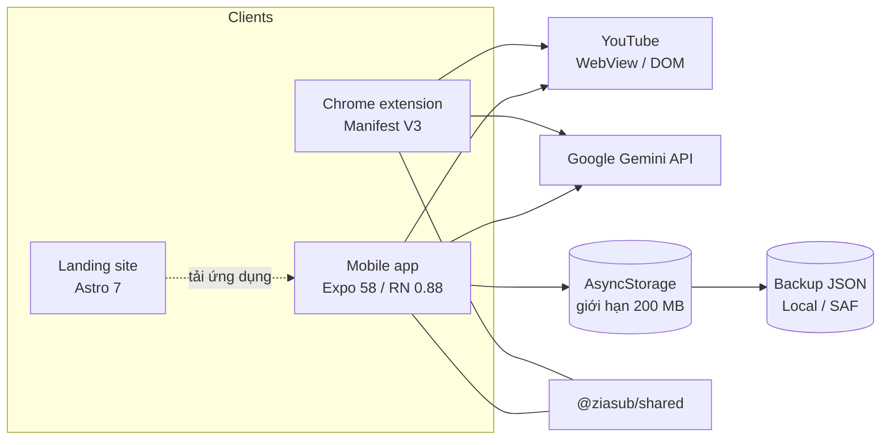

<p align="center">
  
</p>

<h1 align="center">ZiaSub</h1>

<p align="center">
  <strong>Nền tảng xem YouTube với phụ đề dịch tự động bằng Google Gemini</strong><br>
  Ứng dụng di động, tiện ích Chrome và website giới thiệu trong cùng một monorepo.
</p>

<p align="center">
  <a href="#1-tổng-quan">Tổng quan</a> ·
  <a href="#2-kiến-trúc-hệ-thống">Kiến trúc</a> ·
  <a href="#3-tính-năng">Tính năng</a> ·
  <a href="#4-mô-hình-gemini">Mô hình Gemini</a> ·
  <a href="#6-cài-đặt">Cài đặt</a> ·
  <a href="#10-build-và-phát-hành">Build & phát hành</a> ·
  <a href="#13-xử-lý-sự-cố">Xử lý sự cố</a>
</p>

<p align="center">
  
  
  
  
  
  
  
</p>

---

## 1. Tổng quan

**ZiaSub** là bộ công cụ mã nguồn mở giúp xem video YouTube với phụ đề. Ứng dụng mobile dịch phụ đề bằng Google Gemini theo mô hình **BYOK (Bring Your Own Key)**: người dùng tự cung cấp API key, ứng dụng gọi trực tiếp Google API và **không có backend trung gian**. Chrome extension chỉ nhận SRT đã dịch (từ AI Studio hoặc công cụ khác) để hiển thị trên YouTube, không gọi Gemini API.

Repository bao gồm bốn thành phần chính:

| Thành phần | Phiên bản | Công nghệ | Vai trò |
| --- | --- | --- | --- |
| `@ziasub/mobile` | 1.2.1 | Expo SDK 58, React Native 0.88 | Ứng dụng Android/iOS |
| `@ziasub/extension` | 0.1.0 | Chrome Manifest V3, Bun | Dán SRT và hiển thị phụ đề trên YouTube |
| `@ziasub/shared` | 0.0.7 | TypeScript | Types, SRT parser, i18n, tiện ích dùng chung |
| `@ziasub/landing` | 0.0.1 | Astro 7, React 19, Tailwind 4 | Website giới thiệu và tải ứng dụng |

**Nguyên tắc thiết kế**

- **Local-first:** cấu hình, API key, bản dịch và lịch sử chat của mobile được lưu trên thiết bị; extension chỉ lưu cấu hình hiển thị trong `chrome.storage`.
- **Không backend:** mobile gọi thẳng Google Generative Language API; extension không gọi dịch vụ AI nào.
- **Đa nền tảng:** dùng chung types, parser SRT và bản dịch giữa mobile và extension.
- **Cấu hình bằng config plugin:** các thay đổi native được tái tạo tự động mỗi lần `expo prebuild`, không sửa tay thư mục `android/`.

Tài liệu được cập nhật ngày **17/11/2026**.

## 2. Kiến trúc hệ thống

### 2.1. Sơ đồ tổng thể



### 2.2. Luồng dịch phụ đề trên mobile

1. WebView tải YouTube và inject script để đọc danh sách phụ đề (hoặc dùng chế độ presub).
2. `translationManager` chia nội dung thành batch theo cấu hình thời lượng, offset và số batch song song.
3. `geminiService` gọi Gemini với model, thinking level và preset prompt đã chọn.
4. `keyManager` xoay vòng nhiều API key khi gặp rate limit và áp dụng retry có kiểm soát.
5. Kết quả được lưu vào AsyncStorage, hiển thị overlay theo thời gian thực và có thể xuất SRT.
6. `queueManager` và background service tiếp tục xử lý hàng đợi khi ứng dụng chạy nền, sau đó gửi thông báo.

### 2.3. Cấu trúc thư mục

```text
ZiaSub/
├── packages/
│   ├── mobile/                     # Ứng dụng Expo / React Native
│   │   ├── plugins/                # Config plugin native
│   │   ├── src/
│   │   │   ├── components/         # UI components
│   │   │   ├── contexts/           # React contexts
│   │   │   ├── hooks/              # Custom hooks
│   │   │   ├── screens/            # Màn hình
│   │   │   ├── services/           # Gemini, queue, storage, backup, update
│   │   │   ├── utils/              # Storage và tiện ích
│   │   │   └── i18n/               # Khởi tạo i18next
│   │   └── assets/                 # Icon, splash
│   ├── extension/
│   │   ├── src/
│   │   │   ├── background/         # Service worker
│   │   │   ├── content/            # Content script trên YouTube
│   │   │   ├── popup/              # Popup UI
│   │   │   └── options/            # Trang cấu hình
│   │   └── public/                 # Manifest, icon, build output
│   ├── shared/
│   │   └── src/
│   │       ├── types/              # TypeScript definitions
│   │       ├── utils/              # SRT parser, video utils
│   │       └── i18n/               # Bản dịch dùng chung
│   └── landing/                    # Website Astro
├── scripts/                        # PowerShell tooling
├── package.json                    # Bun workspace root
└── bun.lock
```

## 3. Tính năng

### 3.1. Ứng dụng mobile

| Nhóm | Chức năng |
| --- | --- |
| Xem video | YouTube WebView tối ưu, phụ đề overlay, fullscreen, xoay màn hình, Shorts, CSS responsive cho giao diện desktop |
| Dịch phụ đề | Gemini 4 và các dòng Flash/Flash-Lite, 15 preset prompt, batch song song, streaming, resume, dịch lại theo batch, dịch theo khoảng thời gian, presub |
| Hàng đợi | Thêm video từ thumbnail, dịch hàng loạt, chạy nền, theo dõi tiến độ, tạm dừng/tiếp tục/xóa |
| Chat AI | Hỏi đáp theo nội dung video, chọn khoảng thời gian, lưu lịch sử |
| Thông báo | Thông báo hoàn tất, tiến độ batch và lỗi; lọc theo nguồn |
| API key | Nhiều key, xoay vòng khi rate limit, retry thông minh |
| Dữ liệu | Backup/restore qua bộ nhớ cục bộ hoặc SAF, giới hạn AsyncStorage 200 MB |
| Khác | Xuất SRT, kiểm tra cập nhật qua GitHub Releases, giao diện Việt/Anh |

### 3.2. Chrome extension

- Dán hoặc chọn file SRT, tự phát hiện SRT trong clipboard và xuất lại SRT.
- Hiển thị phụ đề trên trang YouTube, đồng bộ theo thời gian video, hỗ trợ fullscreen, Shorts và chuyển trang SPA.
- Tùy chỉnh đầy đủ kiểu phụ đề: font, màu, nền, viền, bóng, bố cục dọc/ngang, animation và preset.
- Trang options hỗ trợ giao diện sáng/tối/theo hệ thống và tiếng Việt/tiếng Anh.
- Nút AI Studio chỉ mở công cụ bên ngoài để dịch thủ công; extension **không** gọi Gemini API và không quản lý API key, hàng đợi hay lịch sử video.
- Quyền: `storage`, `activeTab`, `scripting`, `clipboardRead`, `clipboardWrite` và host `*://*.youtube.com/*`.

### 3.3. Shared package và landing site

- `@ziasub/shared`: types, parser SRT, tiện ích video và bản dịch dùng chung cho mobile/extension.
- `@ziasub/landing`: website Astro giới thiệu sản phẩm, tối ưu tĩnh và có thể triển khai lên bất kỳ static host nào.

## 4. Mô hình Gemini

Toàn bộ danh mục model, metadata deprecated và cấu hình thinking được quản lý tập trung tại `packages/mobile/src/services/geminiModelConfig.ts`. SDK `@google/genai` phiên bản **3.4.0** sử dụng API ổn định `v1`.

### 4.1. Model đang hỗ trợ

| Model | ID | Thinking level | Trạng thái |
| --- | --- | --- | --- |
| Gemini 4 Hydrogen | `models/gemini-4-hydrogen` | LOW, MEDIUM, HIGH, XHIGH | Hoạt động — mặc định cho dịch phụ đề |
| Gemini 4 Argon | `models/gemini-4-argon` | LOW, MEDIUM, HIGH | Hoạt động |
| Gemini 4 Carbon | `models/gemini-4-carbon` | LOW, MEDIUM, HIGH | Hoạt động |
| Gemini 3.8 Flash | `models/gemini-3.8-flash` | LOW, MEDIUM, HIGH | Hoạt động |
| Gemini 3.6 Flash | `models/gemini-3.6-flash` | MINIMAL, LOW, MEDIUM, HIGH | Hoạt động |
| Gemini 3.5 Flash-Lite | `models/gemini-3.5-flash-lite` | MINIMAL, LOW, MEDIUM, HIGH | Hoạt động — mặc định cho chat và presub |
| Gemini 3.7 Flash | `models/gemini-3.7-flash` | LOW, MEDIUM, HIGH | Deprecated — thay thế bởi 3.8 Flash |
| Gemini 3.5 Flash | `models/gemini-3.5-flash` | MINIMAL, LOW, MEDIUM, HIGH | Deprecated — thay thế bởi 3.6 Flash |
| Gemini 3.1 Flash-Lite | `models/gemini-3.1-flash-lite` | MINIMAL, LOW, MEDIUM, HIGH | Deprecated — ngừng hoạt động 07/05/2027 |

**Quy tắc tương thích**

- `MINIMAL` không được gửi tới Gemini 4 Carbon/Argon/Hydrogen, 3.8 Flash và 3.7 Flash; ứng dụng tự hạ xuống `LOW`.
- `XHIGH` chỉ khả dụng với Gemini 4 Hydrogen; model khác tự hạ xuống `HIGH`.
- Model deprecated **không bị xóa khỏi UI**. Người dùng vẫn có thể chọn, nhưng thấy nhãn cảnh báo, model thay thế và ngày khai tử (nếu Google đã công bố).

### 4.2. Tự động migration model cũ

Các ID đã bị Google ngừng phục vụ được tự động ánh xạ khi tải cấu hình đã lưu:

| ID cũ | Model thay thế |
| --- | --- |
| `models/gemini-2.5-pro` | Gemini 4 Hydrogen |
| `models/gemini-flash-latest` | Gemini 4 Hydrogen |
| `models/gemini-pro-latest` | Gemini 4 Carbon |
| `models/gemini-flash-lite-latest` | Gemini 3.5 Flash-Lite |
| `models/gemini-3-flash-preview` | Gemini 3.8 Flash |
| `models/gemini-3.1-pro-preview` | Gemini 4 Carbon |

### 4.3. Quản lý API key

1. Truy cập [Google AI Studio](https://aistudio.google.com/app/apikey) và tạo API key.
2. Mở **Cài đặt → API Keys** trong ứng dụng mobile.
3. Thêm một hoặc nhiều key. Khi một key bị giới hạn, ứng dụng tự chuyển sang key kế tiếp.

Không cần tạo file `.env`. API key không được nhúng vào mã nguồn hay APK. Chrome extension không có API key và không gọi Gemini API; người dùng dịch SRT bằng AI Studio hoặc công cụ khác rồi dán vào extension.

## 5. Yêu cầu hệ thống

### 5.1. Công cụ bắt buộc

| Công cụ | Yêu cầu | Đã kiểm chứng |
| --- | --- | --- |
| Node.js | ≥ 22.12.0 | 26.13.1 |
| Bun | ≥ 1.4 | 1.4.4 |
| JDK | ≥ 17 | OpenJDK 25.0.5 |
| Git | Phiên bản hiện hành | — |
| Android Studio | Bản mới nhất hỗ trợ Expo SDK 58 | — |
| Xcode | Bản mới nhất hỗ trợ Expo SDK 58 (chỉ macOS/iOS) | — |
| PowerShell | ≥ 5.1 (script Windows) | — |

### 5.2. Android SDK

| Thành phần | Phiên bản |
| --- | --- |
| Compile SDK | 37 |
| Target SDK | 36 |
| Min SDK | 24 (Android 7.0) |
| Build Tools | 37.0.0 |
| NDK | 27.1.12297006 |
| CMake | 3.31.6 (kèm Ninja 1.12.1) |
| Gradle | 9.4.1 |
| Android Gradle Plugin | 9.2.1 |

Cài **Android SDK Platform 37**, **Build Tools 37.0.0**, **NDK 27.1.12297006** và **CMake 3.31.6** qua SDK Manager. Ứng dụng dùng package name `com.tomisakae.ziasub`.

## 6. Cài đặt

### 6.1. Clone và cài dependencies

```bash
git clone https://github.com/PhuVinhAI/ZiaSub.git
cd ZiaSub
bun install
```

Build package dùng chung trước khi chạy mobile hoặc extension:

```bash
bun shared:build
```

### 6.2. Chạy ứng dụng mobile

```bash
# Build native Android và chạy trên thiết bị/emulator
bun mobile:android

# Chạy iOS (macOS + Xcode)
bun run --cwd packages/mobile ios

# Khởi động Metro ở chế độ tunnel và xóa cache
bun mobile:start
```

Ứng dụng sử dụng native module (background service, notification, reanimated), vì vậy hãy dùng **development build** thay vì Expo Go.

### 6.3. Chạy extension

```bash
# Build production
bun extension:build

# Watch mode
bun extension:dev
```

Sau đó mở `chrome://extensions`, bật **Developer mode**, chọn **Load unpacked** và trỏ tới `packages/extension/public`.

### 6.4. Chạy landing site

```bash
bun landing:dev
# hoặc build tĩnh
bun landing:build
```

Landing site yêu cầu Node.js ≥ 22.12.0.

## 7. Cấu hình

### 7.1. Cấu hình ứng dụng

| Tệp | Nội dung |
| --- | --- |
| `packages/mobile/app.json` | Tên, slug, version, versionCode, package name, quyền Android, danh sách config plugin |
| `packages/mobile/package.json` | Dependencies và script của mobile |
| `packages/mobile/src/services/geminiModelConfig.ts` | Danh mục model, deprecated, thinking level |
| `packages/mobile/src/services/storageDefaults.ts` | Giá trị mặc định của ứng dụng |
| `packages/extension/public/manifest.json` | Manifest V3, quyền và entry point |
| `packages/shared/src/i18n/locales/` | Chuỗi bản dịch Việt/Anh dùng chung |

### 7.2. Config plugin native

| Plugin | Tác dụng |
| --- | --- |
| `withInstallApkPermission` | Thêm quyền cài đặt APK cho tính năng cập nhật |
| `withReleaseSigning` | Cấu hình ký release từ keystore bên ngoài repository |
| `withAsyncStorageSize` | Tăng giới hạn AsyncStorage lên 200 MB |
| `withAndroidLongPathFix` | Ép CMake 3.31.6 (Ninja 1.12.1) và chuyển staging directory của app/native module sang `C:/tmp/cxx` trên Windows |

Không chỉnh sửa trực tiếp `packages/mobile/android/` hoặc `ios/`; các thư mục này được tạo lại bởi `expo prebuild`.

### 7.3. Lưu trữ và backup

- Dữ liệu chính nằm trong AsyncStorage với giới hạn 200 MB.
- Backup là tệp JSON, lưu tại thư mục do người dùng chọn (đường dẫn cục bộ hoặc SAF).
- Backup có thể chứa cấu hình, API key, lịch sử chat, bản dịch và hàng đợi. Xem [mục 12](#12-bảo-mật-và-quyền-riêng-tư) trước khi chia sẻ tệp backup.

## 8. Scripts

| Lệnh | Mô tả |
| --- | --- |
| `bun mobile:start` | Khởi động Expo với tunnel và xóa cache |
| `bun mobile:android` | Build native Android và chạy ứng dụng |
| `bun run --cwd packages/mobile ios` | Build native iOS và chạy ứng dụng |
| `bun run --cwd packages/mobile typecheck` | Kiểm tra TypeScript cho mobile |
| `bun landing:dev` | Chạy Astro dev server ở background |
| `bun landing:build` | Build landing site tĩnh |
| `bun extension:dev` | Build extension ở chế độ watch |
| `bun extension:build` | Build extension vào `packages/extension/public/dist` |
| `bun shared:build` | Build shared package vào `packages/shared/dist` |

Script tiện ích:

```powershell
# Đóng gói source theo danh sách file Git
.\scripts\zip-project.ps1 -ProjectPath .

# Script cũ hỗ trợ sửa long path thủ công (chỉ dùng khi cần phục hồi)
.\scripts\fix-android-long-path.ps1
```

## 9. Kiểm thử và chất lượng

Repository hiện chưa có CI workflow hoặc bộ test tự động. Các lệnh sau là **quality gate tối thiểu** trước khi merge:

```bash
# Type checking
bun run --cwd packages/mobile typecheck
bun run --cwd packages/shared typecheck
bun run --cwd packages/extension typecheck

# Build kiểm tra
bun shared:build
bun extension:build
bun landing:build

# Kiểm tra cấu hình Expo
cd packages/mobile && bunx expo-doctor
```

`expo-doctor` được cấu hình bỏ qua kiểm tra React Native Directory cho `react-native-background-actions` vì package này không khai báo metadata tương thích.

Ngoài ra, luôn kiểm tra thủ công các luồng: thêm API key, dịch mới, resume, dịch lại batch, xuất SRT, backup/restore và cập nhật ứng dụng.

## 10. Build và phát hành

### 10.1. Nguyên tắc chung

- Phiên bản mobile hiện tại: **1.2.1**, `versionCode` **3**.
- Mỗi bản phát hành phải tăng `version` và `versionCode` trong `packages/mobile/app.json`.
- APK release phải được ký bằng cùng một keystore để người dùng cập nhật đè lên bản cũ.
- Không commit keystore, mật khẩu hoặc `local.properties` của máy cá nhân.

### 10.2. Chuẩn bị release signing

Tạo thư mục `packages/mobile/release-signing/` (đã nằm trong `.gitignore`) gồm:

```text
packages/mobile/release-signing/
├── keystore.properties
└── ziasub-release.jks
```

Nội dung `keystore.properties`:

```properties
storeFile=ziasub-release.jks
storePassword=<mật-khẩu-store>
keyAlias=<alias>
keyPassword=<mật-khẩu-key>
```

Đường dẫn `storeFile` tương đối được tính từ thư mục chứa `keystore.properties`. Có thể đặt file properties ở vị trí khác và trỏ tới bằng biến môi trường:

```bash
export ZIASUB_KEYSTORE_PROPERTIES=/duong/dan/tuyet/doi/keystore.properties
```

Plugin `withReleaseSigning` sẽ dừng build nếu tác vụ release được yêu cầu nhưng thiếu file hoặc thiếu một trong bốn khóa trên. Build debug không yêu cầu keystore release.

### 10.3. Build APK release cục bộ

```bash
cd packages/mobile
bunx expo prebuild --clean --no-install

cd android
./gradlew assembleRelease
# Windows CMD/PowerShell: gradlew.bat assembleRelease
```

Kết quả (tên file lấy động theo `expo.version` trong `app.json`):

```text
packages/mobile/android/app/build/outputs/apk/release/ziasub-v1.2.1.apk
```

Kiểm tra chữ ký:

```bash
"$ANDROID_HOME/build-tools/37.0.0/apksigner" verify --print-certs \
  packages/mobile/android/app/build/outputs/apk/release/ziasub-v1.2.1.apk
```

### 10.4. Build bằng EAS

Cấu hình tại `packages/mobile/eas.json`:

- `appVersionSource: remote`
- profile `production`: `autoIncrement: true`, Android `buildType: apk`, channel `production`

```bash
cd packages/mobile
bunx eas-cli build --platform android --profile production
```

Khi build trên EAS, cần cung cấp keystore properties qua file secret và biến môi trường `ZIASUB_KEYSTORE_PROPERTIES` để plugin ký release hoạt động.

### 10.5. Build extension và landing

```bash
# Extension: nạp thư mục packages/extension/public vào Chrome
bun extension:build

# Landing: output tĩnh tại packages/landing/dist
bun landing:build
```

### 10.6. Phát hành và cập nhật trong ứng dụng

Ứng dụng kiểm tra bản mới tại GitHub Releases của `PhuVinhAI/ZiaSub`:

1. Tăng version và versionCode.
2. Build APK release đã ký.
3. Tạo Git tag dạng `v1.2.1` và GitHub Release.
4. Đính kèm APK có đuôi `.apk` vào release.
5. Ứng dụng so sánh semantic version, tải APK và mở trình cài đặt (cập nhật không bắt buộc).

Nếu APK được ký bằng keystore khác, Android sẽ từ chối cập nhật đè.

### 10.7. Checklist phát hành

- [ ] Cập nhật `version` và tăng `versionCode` trong `packages/mobile/app.json`.
- [ ] Đồng bộ `version` trong `packages/mobile/package.json`.
- [ ] Cập nhật `CHANGELOG.md` nếu có thay đổi người dùng nhìn thấy.
- [ ] Chạy toàn bộ quality gate ở [mục 9](#9-kiểm-thử-và-chất-lượng).
- [ ] Build APK release và xác minh chữ ký.
- [ ] Kiểm tra cài mới, nâng cấp đè và backup/restore.
- [ ] Tạo GitHub Release kèm APK.

## 11. Windows và giới hạn độ dài đường dẫn

Android SDK mặc định dùng CMake 3.22.1, đi kèm Ninja 1.10.2 — phiên bản từ chối mọi đường dẫn dài hơn 260 ký tự. Native build của React Native tạo object path rất sâu trong `node_modules`, đặc biệt ở codegen của New Architecture. Dự án xử lý bằng hai lớp:

1. Yêu cầu **CMake 3.31.6** (đi kèm Ninja 1.12.1 có hỗ trợ long path).
2. Dùng config plugin `packages/mobile/plugins/withAndroidLongPathFix.js` để giảm độ sâu thư mục build.

Trên Windows, plugin tự động:

- Thêm `android.cmakeVersion=3.31.6` vào `gradle.properties` (chỉ trên Windows, không ảnh hưởng build Linux/EAS).
- Chèn `buildStagingDirectory "C:/tmp/cxx"` vào `android/app/build.gradle`.
- Đặt `buildStagingDirectory` thành `C:/tmp/cxx/<module>` cho mọi Android subproject, bao gồm native module trong `node_modules` như Reanimated.
- Tạo thư mục `C:/tmp` nếu chưa tồn tại.
- Thêm `org.gradle.caching=true` vào `gradle.properties`.

Cài CMake 3.31.6 bằng Android Studio (**SDK Tools → CMake**) hoặc dòng lệnh:

```bash
"$ANDROID_HOME/cmdline-tools/latest/bin/sdkmanager" --install "cmake;3.31.6"
```

Bật long path ở cấp hệ thống (chạy PowerShell với quyền Administrator, sau đó khởi động lại máy):

```powershell
New-ItemProperty -Path "HKLM:\SYSTEM\CurrentControlSet\Control\FileSystem" -Name "LongPathsEnabled" -Value 1 -PropertyType DWORD -Force
```

Kiểm tra lại:

```powershell
(Get-ItemProperty -Path "HKLM:\SYSTEM\CurrentControlSet\Control\FileSystem").LongPathsEnabled
```

Giá trị phải là `1`. `git config core.longpaths true` chỉ ảnh hưởng thao tác checkout của Git, không ảnh hưởng Ninja/CMake.

Cấu hình của plugin được áp dụng lại mỗi lần chạy:

```bash
cd packages/mobile
bunx expo prebuild --clean --no-install
```

Sau khi đổi CMake hoặc plugin, xóa cache native cũ nếu cần:

```bash
rm -rf packages/mobile/android/app/.cxx packages/mobile/android/app/build
```

Nếu Gradle báo `EBUSY` khi prebuild, đóng Android Studio và dừng daemon:

```bash
cd packages/mobile/android
./gradlew --stop
```

Script `scripts/fix-android-long-path.ps1` là công cụ phục hồi thủ công cho môi trường cũ; không cần chạy khi plugin đã được bật.

## 12. Bảo mật và quyền riêng tư

### 12.1. Mô hình dữ liệu

- **Không có backend ZiaSub.** Mobile gọi trực tiếp Google Gemini API qua HTTPS; extension không gọi AI.
- API key chỉ được lưu trong AsyncStorage trên mobile. Extension chỉ lưu cấu hình hiển thị trong `chrome.storage`.
- AsyncStorage và `chrome.storage` **không được mã hóa ở tầng ứng dụng**; dữ liệu dựa vào sandbox của hệ điều hành và quyền truy cập thiết bị.
- Nội dung gửi tới Gemini (chỉ từ mobile) bao gồm phụ đề, prompt hệ thống, nội dung chat và ngữ cảnh video do người dùng chọn.

### 12.2. Backup

Tệp backup là JSON **không mã hóa** và có thể chứa:

- Danh sách API key và cấu hình Gemini.
- Lịch sử chat.
- Bản dịch và tệp SRT.
- Hàng đợi dịch và cài đặt ứng dụng.

Không chia sẻ backup qua kênh công khai. Nếu cần chuyển máy, hãy lưu tệp ở vị trí an toàn và xóa tệp sau khi hoàn tất.

### 12.3. Khóa ký ứng dụng

- Keystore và mật khẩu chỉ tồn tại ngoài repository, trong `packages/mobile/release-signing/`.
- `.gitignore` chặn `*.jks`, `*.keystore`, `*.p12`, `*.key` và thư mục release-signing.
- Không đưa mật khẩu vào log, issue, screenshot hoặc biến môi trường công khai.

### 12.4. Quyền Android

| Quyền | Mục đích |
| --- | --- |
| `POST_NOTIFICATIONS` | Thông báo hoàn tất dịch và lỗi |
| `FOREGROUND_SERVICE` | Duy trì tiến trình dịch |
| `FOREGROUND_SERVICE_DATA_SYNC` | Đồng bộ dữ liệu dịch khi chạy nền |
| `WAKE_LOCK` | Giữ CPU hoạt động trong lúc xử lý hàng đợi |
| `REQUEST_INSTALL_PACKAGES` | Cài APK cập nhật do người dùng chủ động tải |

### 12.5. Kênh liên lạc ra ngoài

- Google Generative Language API (`generativelanguage.googleapis.com`) cho dịch và chat.
- GitHub API để kiểm tra bản phát hành mới.
- YouTube qua WebView hoặc content script.

Mã nguồn không tích hợp SDK quảng cáo hay analytics bên thứ ba. Nếu phát hiện lỗ hổng bảo mật, vui lòng mở **private security advisory** tại repository thay vì tạo issue công khai.

## 13. Xử lý sự cố

| Hiện tượng | Nguyên nhân thường gặp | Cách xử lý |
| --- | --- | --- |
| `expo prebuild` báo `EBUSY` | Gradle/Kotlin daemon hoặc Android Studio đang giữ thư mục `android/` | Đóng Android Studio, chạy `./gradlew --stop`, sau đó prebuild lại |
| Ninja báo không tạo được thư mục, đường dẫn quá dài | Giới hạn 260 ký tự của CMake/Ninja | Kiểm tra plugin `withAndroidLongPathFix` đã có trong `app.json`; chạy prebuild sạch; đảm bảo ghi được `C:/tmp` |
| `Release keystore properties not found` | Thiếu file hoặc sai biến `ZIASUB_KEYSTORE_PROPERTIES` | Tạo đủ bốn khóa trong `keystore.properties`; kiểm tra đường dẫn tuyệt đối |
| `Invalid hook call` hoặc lỗi React trùng phiên bản | Nhiều bản React trong workspace | Chạy `bun install` ở root; kiểm tra `bun pm ls react` và đảm bảo mobile/landing dùng React 19.3.0 |
| Metro không nhận thay đổi | Cache cũ | `bun mobile:start` (đã có `--clear`) hoặc `bunx expo start -c` |
| `expo-doctor` cảnh báo `react-native-background-actions` | Package thiếu metadata React Native Directory | Đã loại trừ có chủ đích trong `packages/mobile/package.json` |
| API trả 403/404 với model | Key không có quyền hoặc model đã bị Google gỡ | Chọn model còn hoạt động trong Cài đặt; kiểm tra key tại AI Studio |
| API trả 429 | Hết hạn mức key hiện tại | Thêm key khác; ứng dụng sẽ tự xoay vòng và retry |
| Android chặn cài bản cập nhật | Chưa cấp quyền cài ứng dụng không rõ nguồn | Cho phép ZiaSub cài đặt ứng dụng trong cài đặt hệ thống |
| Landing build lỗi do Node | Node cũ hơn yêu cầu | Nâng Node.js lên ≥ 22.12.0 |

## 14. Đóng góp

1. Fork repository và tạo branch theo quy ước:
   - `feat/<mô-tả-ngắn>`
   - `fix/<mô-tả-ngắn>`
   - `docs/<mô-tả-ngắn>`
2. Commit theo [Conventional Commits](https://www.conventionalcommits.org/), ví dụ `feat(mobile): add batch retranslation`.
3. Giữ thay đổi tập trung; không trộn refactor lớn với sửa lỗi.
4. Với thay đổi native, ưu tiên config plugin thay vì sửa trực tiếp thư mục generate.
5. Với chuỗi UI mới, cập nhật đồng thời bản dịch Việt và Anh trong `packages/shared/src/i18n/locales/`.
6. Với model Gemini mới, cập nhật tập trung tại `geminiModelConfig.ts`, metadata deprecated và UI cảnh báo.
7. Chạy toàn bộ quality gate ở [mục 9](#9-kiểm-thử-và-chất-lượng) trước khi mở Pull Request.

**Không commit:**

- `packages/mobile/android/`, `packages/mobile/ios/` (thư mục generate).
- `packages/mobile/release-signing/`, keystore hoặc mật khẩu.
- `local.properties`, log build, `node_modules/`, `dist/`.

Báo lỗi tại [GitHub Issues](https://github.com/PhuVinhAI/ZiaSub/issues) với mô tả, bước tái tạo, phiên bản ứng dụng, thiết bị và log liên quan (đã loại bỏ API key).

## 15. Giấy phép và ghi công

Phát hành theo **MIT License**. Xem [LICENSE](LICENSE).

- Tác giả: **PhuVinhAI** ([@PhuVinhAI](https://github.com/PhuVinhAI))
- Repository: [PhuVinhAI/ZiaSub](https://github.com/PhuVinhAI/ZiaSub)

Các thư viện mã nguồn mở được sử dụng tuân theo giấy phép tương ứng của từng dự án: Expo, React Native, Google GenAI SDK, React Native Paper, i18next, Astro, Tailwind CSS và các dependencies khác trong `package.json`.
